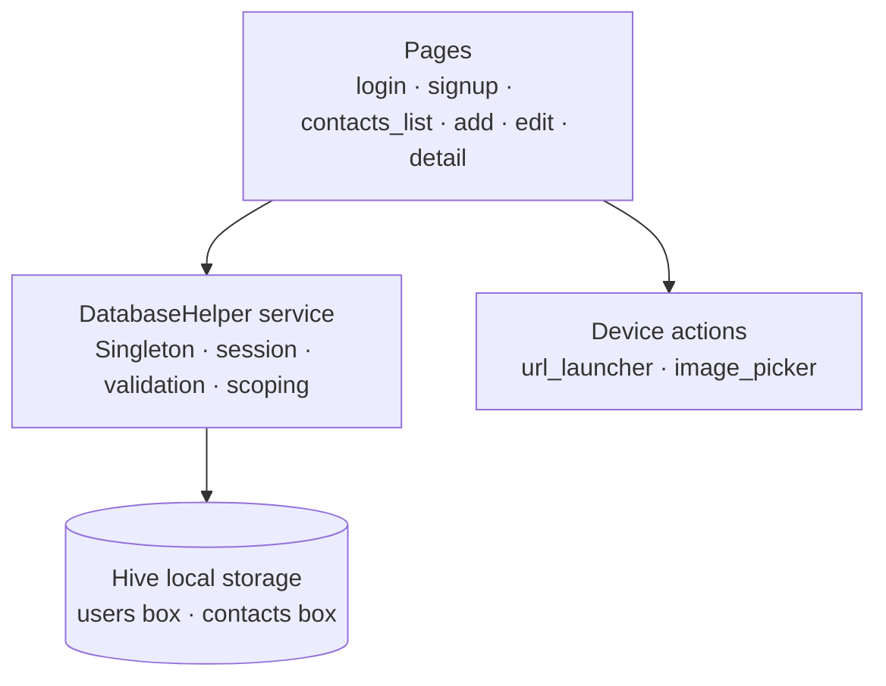

<p align="center">
  
</p>

<div align="center"> 
  
# Gestion de Contacts - Flutter Application

**Cross-platform contact management application with user accounts, offline-first storage, favorites and one-tap communication actions.**


</div>
  
## Table of Contents

- [Project Overview](#project-overview)
- [Business Context and Problem Statement](#business-context-and-problem-statement)
- [Project Objectives](#project-objectives)
- [Main Features](#main-features)
- [System Architecture](#system-architecture)
- [Part I - Authentication and User Management](#part-i---authentication-and-user-management)
- [Part II - Contact Management](#part-ii---contact-management)
- [Part III - Quick Actions and Device Integration](#part-iii---quick-actions-and-device-integration)
- [Technology Stack](#technology-stack)
- [Data Model and Local Storage](#data-model-and-local-storage)
- [Platform Support](#platform-support)
- [Security and Privacy](#security-and-privacy)
- [Installation and Configuration](#installation-and-configuration)
- [Running the Application](#running-the-application)
- [Project Structure](#project-structure)
- [Testing and Validation](#testing-and-validation)
- [Current Limitations](#current-limitations)
- [Future Improvements](#future-improvements)
- [Contributors](#contributors)

## Project Overview

Gestion de Contacts is a Flutter application for creating, organizing and using personal and professional contacts. It combines an account layer (sign-up, login, session management), a complete contact lifecycle (create, read, update, delete), an offline local database, and one-tap actions such as phone call, WhatsApp, email and Google Maps.

The repository contains the complete Flutter application: the Dart source code, the Hive data layer, the platform runners (Android, iOS, Web and desktop) and the application assets. Everything runs locally on the device; no backend or external service is required.

## Business Context and Problem Statement

Contact information is often scattered between the phone's native address book, spreadsheets, notebooks and messaging applications. This makes it difficult to keep a single, up-to-date and searchable directory, and it offers no separation between the contact lists of different users of the same device or account.

Gestion de Contacts addresses this situation by providing:

- A dedicated application with per-user accounts and isolated contact lists.
- A single place to store identity, phone, email, address and photo for every contact.
- Instant search and alphabetical organization of large contact lists.
- Favorites for fast access to the most important contacts.
- Direct communication actions (call, WhatsApp, email) and geolocation of the contact's address.
- Fully offline storage, so the contact book is available without a network connection.

## Project Objectives

1. Centralize contact management (create, edit, delete, search) in a single mobile-first application.
2. Separate the data of each user through authenticated accounts and per-user contact scopes.
3. Provide a clean, responsive and accessible user interface built with Material Design.
4. Store data locally and reliably with a lightweight embedded NoSQL database (Hive).
5. Reduce the time between finding a contact and acting on it (call, message, email, route).
6. Guarantee data quality through form validation and duplicate phone-number prevention.
7. Establish a modular code structure (models, services, pages) that is easy to extend and test.

## Main Features

| Area | Confirmed capabilities in this repository |
| --- | --- |
| Authentication | Sign-up and login with validated forms, local session management and logout confirmation |
| Account safety | Email uniqueness check at registration, mandatory password length rule, email format validation |
| Contact management | Create, read, update and delete contacts with last name, first name, phone, email, address and photo |
| Search & organization | Live search by name or phone number, alphabetical sorting, favorites with one-tap toggle |
| Quick actions | Phone call, WhatsApp message, email and Google Maps launched from the contact detail screen |
| User interface | Deep-purple Material theme, fade animations, slide actions, dialogs and snackbar feedback |
| Data storage | Fully offline Hive boxes with per-user isolation and sequential contact identifiers |
| Platforms | Android, iOS, Web, Linux, macOS and Windows runners included |

## System Architecture

The application follows a simple three-layer architecture. The presentation layer (Flutter pages) collects user input and renders state. The service layer (`DatabaseHelper`, a singleton) centralizes business rules such as authentication, duplicate checks and per-user scoping. The persistence layer (Hive boxes) stores users and contacts on the device.




## Part I - Authentication and User Management

### Purpose and Architecture

The account layer protects access to the contact book and isolates the data of each user. `LoginPage` and `SignUpPage` collect credentials, `DatabaseHelper` verifies or creates the account in the `users` box, and the session object (`currentUser`) is attached to every subsequent contact operation.

### Sign-up and Validation Rules

| Field | Rule enforced by the forms |
| --- | --- |
| Nom / Prénom | Required, non-empty |
| Téléphone | Required, digits validated after normalization |
| Email | Required, format checked against the pattern `^[\w-\.]+@([\w-]+\.)+[\w-]{2,4}$`, uniqueness checked against the `users` box |
| Mot de passe | Required, minimum 6 characters |

### Authentication and Session Lifecycle

1. The user submits credentials to the login form.
2. The service looks up the account by email in the `users` box and compares the password.
3. On success, the user is attached to the application session and a welcome feedback is displayed.
4. The application navigates to the contact list; unauthenticated access redirects to the login page.
5. Every contact query is scoped to the identifier of the connected user.
6. Logout asks for confirmation, clears the session and returns to the login page.


## Part II - Contact Management

### Purpose and Architecture

The contact lifecycle is implemented across four pages: `ContactsListPage` (browse, search, favorite, delete), `AddContactPage` and `EditContactPage` (validated forms with optional photo), and `ContactDetailPage` (full profile and actions). All persistence goes through `DatabaseHelper`.

### Confirmed Capabilities

- **Create** — form with last name, first name, phone, email, address and an optional photo picked from the camera or the gallery (`image_picker`).
- **Read** — alphabetical contact list with initial-based avatars, live filtering and a detail view.
- **Update** — pre-filled form that preserves the favorite flag and the creation date.
- **Delete** — confirmation dialog, available from the detail page and from the list.
- **Favorites** — star toggle from the list and from the detail page.
- **Search** — real-time filtering on first name, last name and phone number.
- **Data quality** — duplicate phone numbers are rejected per user; form fields are validated before saving.

### Storage Conventions

- Contacts are keyed as `userId_contactId` in the `contacts` box, which guarantees isolation between users.
- Contact identifiers are sequential per user, generated by the data layer.
- A creation timestamp is attached to every new contact.

## Part III - Quick Actions and Device Integration

The contact detail page turns stored information into immediate actions, implemented with `url_launcher`:

| Action | Launch target | Behavior |
| --- | --- | --- |
| Call | `tel:<phone>` | Opens the system dialer |
| WhatsApp | `https://wa.me/<phone>` | Opens WhatsApp with the cleaned phone number |
| Email | `mailto:<email>` | Opens the default mail client (when an email exists) |
| Map | Google Maps search URL | Opens the contact's address in Google Maps |


## Technology Stack

| Layer | Technologies confirmed in the repository |
| --- | --- |
| Application framework | Flutter, Dart SDK `^3.9.2` |
| Local database | Hive `2.2.3`, hive_flutter |
| Code generation | hive_generator, build_runner (adapters in `*.g.dart`) |
| Device integration | url_launcher, image_picker, permission_handler |
| UI components | flutter_slidable, font_awesome_flutter, cupertino_icons, intl |
| Linting | flutter_lints, `analysis_options.yaml` |
| Testing | flutter_test |
| Platforms | Android, iOS, Web, Linux, macOS, Windows runners |

## Data Model and Local Storage

The application uses two Hive boxes:

| Box | Key | Value | Role |
| --- | --- | --- | --- |
| `users` | Email | `User` | Accounts and session lookup |
| `contacts` | `userId_contactId` | `Contact` | Contacts of the connected user |

### `User` model

| Field | Type | Description |
| --- | --- | --- |
| `id` | `int?` | User identifier |
| `nom`, `prenom` | `String` | Identity, exposed as `fullName` |
| `email` | `String` | Unique login key |
| `telephone` | `String` | Contact phone of the account holder |
| `password` | `String` | Credential (see [Current Limitations](#current-limitations)) |
| `createdAt` | `DateTime?` | Registration date |

### `Contact` model

| Field | Type | Description |
| --- | --- | --- |
| `id`, `userId` | `int?`, `int` | Identifier and owner |
| `nom`, `prenom` | `String` | Identity (`fullName`, `initials`, `firstLetter` helpers) |
| `email`, `adresse` | `String?` | Optional coordinates |
| `telephone` | `String` | Primary phone number |
| `photoPath` | `String?` | Path of the picked photo |
| `isFavorite` | `bool` | Favorite flag |
| `createdAt` | `DateTime?` | Creation date |


## Platform Support

| Platform | Runner | Status |
| --- | --- | --- |
| Android | `android/` | Included |
| iOS | `ios/` | Included |
| Web | `web/` | Included |
| Linux | `linux/` | Included |
| macOS | `macos/` | Included |
| Windows | `windows/` | Included |


## Security and Privacy

- **Local-only data** — users and contacts never leave the device; there is no network call in the data layer.
- **Per-user isolation** — contact queries are always scoped to the connected user's identifier in `DatabaseHelper`.
- **Input validation** — email format, password length, required fields and duplicate phone numbers are enforced before persistence.
- **Destructive-action confirmation** — logout and contact deletion require explicit confirmation.
- **No secrets in code** — the application requires no API key, token or environment variable.


## Installation and Configuration

### Prerequisites

- [Flutter SDK](https://docs.flutter.dev/get-started/install) with `flutter` available on your `PATH`
- Dart SDK `^3.9.2` (bundled with recent Flutter versions)
- A device, emulator or browser depending on the target platform

### Steps

```bash
git clone https://github.com/Achref-004/Gestion-contact-flutter.git
cd Gestion-contact-flutter/gestion_contact
flutter pub get
```

If you modify the `User` or `Contact` models, regenerate the Hive adapters:

```bash
dart run build_runner build --delete-conflicting-outputs
```

Static analysis is configured through `analysis_options.yaml` (flutter_lints) and can be run at any time:

```bash
flutter analyze
```

## Running the Application

Start the application on a connected device, emulator or browser:

```bash
cd gestion_contact
flutter run
```

Build a release artifact for a specific platform:

```bash
flutter build apk      # Android
flutter build ios      # iOS (requires macOS and Xcode)
flutter build web      # Web
flutter build windows  # Windows
flutter build linux    # Linux
flutter build macos    # macOS (requires macOS and Xcode)
```

## Project Structure

```
Gestion-contact-flutter/
├── README.md
├── LICENSE
└── gestion_contact/
    ├── lib/
    │   ├── main.dart                  # Application entry point, theme and routes
    │   ├── models/
    │   │   ├── contact.dart           # Contact entity (Hive)
    │   │   ├── contact.g.dart         # Generated Hive adapter
    │   │   ├── user.dart              # User entity (Hive)
    │   │   └── user.g.dart            # Generated Hive adapter
    │   ├── pages/
    │   │   ├── login.dart             # Login page
    │   │   ├── signup.dart            # Registration page
    │   │   ├── contacts_list.dart     # Contact list, search, favorites
    │   │   ├── add_contact_page.dart  # Creation form + photo
    │   │   ├── edit_contact_page.dart # Edition form + photo
    │   │   └── contact_detail_page.dart # Profile + quick actions
    │   └── services/
    │       └── database_helper.dart   # Singleton data layer (Hive)
    ├── assets/                        # Login / sign-up illustrations
    ├── test/                          # Flutter test folder
    ├── android/ ios/ web/             # Platform runners
    ├── linux/ macos/ windows/         # Desktop runners
    ├── pubspec.yaml                   # Dependencies and assets
    └── build.yaml                     # hive_generator configuration
```

## Testing and Validation

- Run `flutter analyze` and confirm there are no errors before submitting changes.
- Verify sign-up validation: empty fields, invalid email format, short password and duplicate email are all rejected.
- Verify login success and failure paths against a development account.
- Verify that every contact operation is scoped to the connected user (create a second account and confirm isolation).
- Verify create, edit and delete flows, including photo pick and the favorite toggle.
- Verify search behavior on first name, last name and phone number, with and without accents/case differences.
- Verify quick actions (call, WhatsApp, email, maps) on a real device, including the missing-email and missing-address error messages.
- Run `flutter test` before a release build.

## Current Limitations

- Picked photos are referenced by their temporary picker path and may disappear when the platform clears its cache.
- There is no cloud synchronization, backup, or contact import/export (vCard, SIM).
- There is no forgotten-password flow or account recovery.

## Future Improvements

1. Hash passwords (e.g. bcrypt) and encrypt the local database at rest.
2. Persist the session in secure storage (`flutter_secure_storage`) with optional auto-login and idle timeout.
3. Copy picked photos into permanent application storage and clean orphaned files.
4. Add cloud backup and cross-device synchronization with offline-first conflict resolution.
5. Implement contact groups/labels, vCard import/export and a duplicate-merge tool.
6. Add automated unit, widget and integration tests, plus continuous integration (`flutter analyze`, `flutter test`).
7. Deliver dark mode, localization (FR / EN / AR) and accessibility improvements.

## Contributors

This project was developed as an academic project. 

| Contributor | Role |
| --- | --- |
| `Bejaoui Achref` | Project development |


---

**Achref Bejaoui**

Master's student in Data Science, with a degree in Business Computing.

Areas of interest:

- Data Science
- Data Analytics
- Artificial Intelligence
- AI Agents
- Machine Learning
- Power BI
- Backend Engineering
- Data Engineering

[LinkedIn](https://linkedin.com/in/achref-bejaoui00) · [GitHub](https://github.com/Achref-004)
